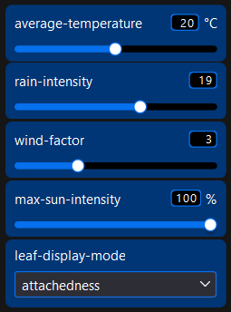
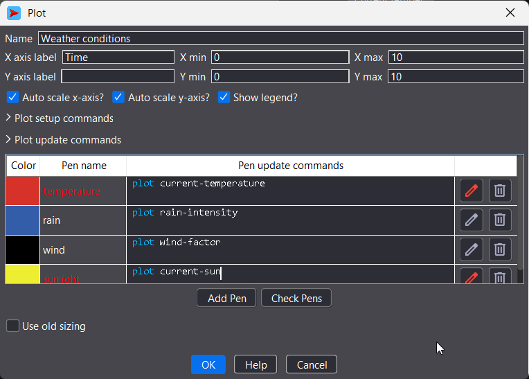
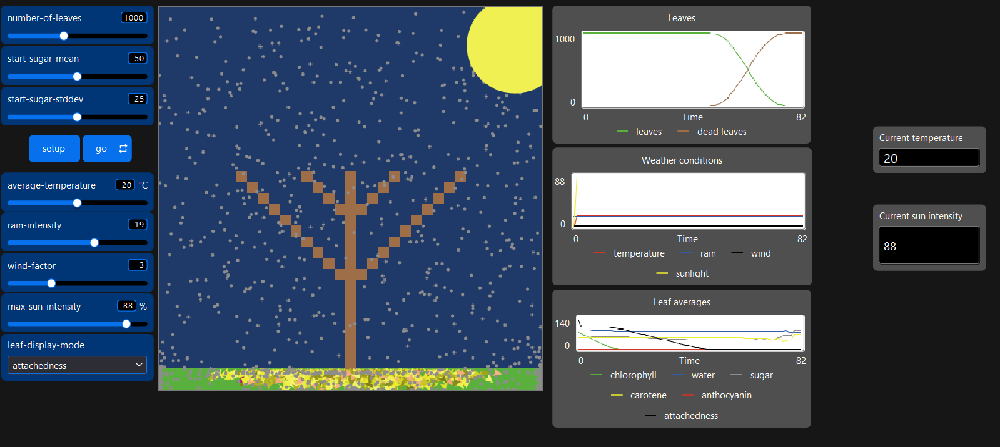

# Комп'ютерні системи імітаційного моделювання
# СПм-25-1, Олешко Владислав Миколайович

## Лабораторна робота №2. Редагування імітаційних моделей у середовищі NetLogo

## Варіант 11. Модель у середовищі NetLogo - Autumn

### Внесені зміни у вихідну логіку моделі, за варіантом:
Додавання добових циклів зміни інтенсивності сонячного світла, що також повинно впливати на температуру. Тривалість модельної "доби" встановлюється у внутрішніх параметрах.

Перед безпосереднім додаванням затребуваних змін я маю внести деякі візуальні правки. Оскільки показники температури та інтенсивності сонця тепер будуть динамічно змінюватись я змінюю підписи на слайдерах temperature та sun-intensity. Параметр температури буде відповідати за середньодобове значення, тому змінюю назву на average-temperature. Параметр інтенсивності сонця тепер буде задавати максимальне значення, оскільки вночі цей показник буде 0 і є сенс визначати лише денний максимум - називаю max-sun-intensity.

Це була лише візуальна зміна, а далі потрібно покроково змінити код. І щоб все було органічно, потрібно на заміну змінененим параметрам задати нові внутрішні. У globals додаю current-temperature та current-sun. Оновлені globals виглядають наступним чином.

<pre>
globals [
  bottom-line          ;; controls where the ground is
  evaporation-temp     ;; temperature at which water evaporates
  current-temperature  ;; current temperature during day
  current-sun          ;; current sun intensity during day
]
</pre>

Далі потрібно оновити використання temperature на current-temperature у процедурах (функціях) adjust-water, adjust-chlorophyll, change-color. А також sun-intensity на current-sun у процедурах adjust-chlorophyll, adjust-sugar, show-intensity. Додаю кілька змінених функцій для прикладу, але не всі через їх розмір.

<pre>
to show-intensity  ;; sun procedure
  set color scale-color yellow current-sun 0 150
  set size current-sun / 10
  set label word current-sun "%"
  ifelse current-sun < 50
    [ set label-color yellow ]
    [ set label-color black  ]
end
</pre>

<pre>
to adjust-chlorophyll
  ;; If the temperature is low, then reduce the chlorophyll
  if current-temperature < 15 [
    set chlorophyll chlorophyll - (.5 * (15 - current-temperature))
  ]
  ;; If the sun is strong, then reduce the chlorophyll
  if current-sun > 75 [
    set chlorophyll chlorophyll - (.5 * (current-sun - 75))
  ]
  ;; New chlorophyll comes from water and sunlight
  if current-temperature > 15 and current-sun > 20 [
    set chlorophyll chlorophyll + 1
  ]
end
</pre>

У функції show-intensity потрібно змінити рядок, що відповідає за відображення %, бо через свою майбутню динамічну поведінку він показуватиме дробові значення. Мета зміни - округлити значення до цілого.

<pre>set label word (precision current-sun 0) "%"</pre>

Додаю зміну у функцію go, щоб задати параметри зі змінених слайдерів у нові змінні.

<pre>
to go
  ;; Stop if all of the leaves are dead
  if not any? leaves [ stop ]
  
  set current-temperature average-temperature
  set current-sun max-sun-intensity

  ;; ... rest of the code
</pre>

Зміни у коді зламали віджет Weather conditions, бо змінились назви змінних. Потрібно оновити їх.

І нарешті можна налаштувати окремі згадані монітори.

